<div align="center">

# 🛡️ ScamShield

**Know before you tap.** Paste a message, drop a screenshot or scan a QR code, and find out in seconds whether it is safe to open.

An explainable scam and phishing checker for **messages, emails, links, screenshots and QR codes**, built for the kinds of scams people in India actually receive: fake KYC, courier fees, digital arrest, UPI traps, job and investment offers.

[](https://github.com/shailkamtikar/scamshield/actions/workflows/ci.yml)


### 👉 [**Try it live: scamshield-smoky.vercel.app**](https://scamshield-smoky.vercel.app/)

Prefer chat? **[Check on Telegram: @ScamshieldAPIbot](https://t.me/ScamshieldAPIbot)**

<sub>Works on phones too. The API runs on a free plan and sleeps when idle, so the very first check after a quiet spell can take up to a minute while it wakes up.</sub>

<br />

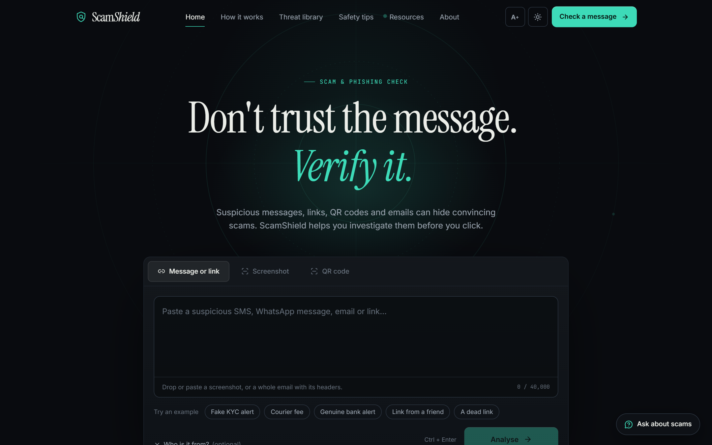

</div>

---

## Contents

[What it does](#what-it-does) · [Telegram bot](#telegram-bot) · [See it in action](#see-it-in-action) · [How it works](#how-it-works) · [What you get back](#what-you-get-back) · [How it behaves](#how-it-behaves) · [Design principles](#design-principles) · [Accuracy](#accuracy-measured-honestly) · [Security and privacy](#security-and-privacy) · [Tech stack](#tech-stack) · [Run it locally](#run-it-locally) · [Deploy](#deployment) · [Limits](#known-limits)

---

## What it does

Most scam checkers only look at a link. ScamShield treats the **whole message as evidence**: the wording, the sender, the links, the QR code, the screenshot. It then gives a plain-language answer with the reasons behind it.

| You have… | ScamShield… |
|---|---|
| **An SMS, WhatsApp message or email** (even a whole email with its headers) | Reads the wording (English, Hindi, Hinglish), finds every link, phone number, UPI ID and email address, and checks the sender, reply-to, attachments and hidden links of a pasted email. |
| **A link** (even defanged, without `https://`, or hidden with look-alike Unicode) | Follows it safely **on the server, never on your device**, checks threat lists, domain age and the page itself, and compares the address against about 500 known organisations. |
| **A screenshot** | Reads it with OCR and Gemini vision, pulls out the sender and links, then runs the same checks. |
| **A QR code** (camera or image) | Decodes it **on your device and never opens it**. UPI and Google Pay QRs show the payee, address and amount; other links get the full investigation. |

The same checks are available in **Telegram**: forward the message to the bot and get the answer in a private chat.

Every answer comes with a **verdict, a score, a confidence figure computed from the evidence, the reasons, and what to do next**. It can also show **who a message is pretending to be**, side by side with the real address.

> ScamShield is an automated assessment, not a guarantee. If you have lost money, call **1930** or report at [cybercrime.gov.in](https://cybercrime.gov.in).

---

## Telegram bot

[**@ScamshieldAPIbot**](https://t.me/ScamshieldAPIbot) runs the same investigation as the website, inside Telegram, so a suspicious message can be checked without leaving the chat it arrived in.

| You do this | The bot does this |
|---|---|
| Forward or paste a suspicious message to the bot | Replies in the private chat with the verdict, the reasons, any real-vs-fake address comparison and what to do |
| Send a screenshot, or a photo of a QR code | Reads it with OCR (screenshots) or decodes it (QR codes), then checks it. A photo that is mostly a code is read as a code |
| In a group, reply to the suspicious message with `@ScamshieldAPIbot` (or `/check`) | Answers **only you**, in your private chat. If you have never pressed Start, it posts a one-line note with a Start link instead |
| Wait 5 to 15 seconds | A "checking" message appears first and is edited into the answer |

**What it never does:** open a link (links in answers are written like `hxxps://example[.]com`), store a message or a file, or answer anyone but the person who asked.

**How it is built.** Telegram calls one webhook on the same FastAPI server that runs the website (`POST /telegram/webhook`). The reply is produced after a quick `200 OK`, using the same pipeline, so there is no second system to keep in step. There is no extra library: [`telegram_api.py`](backend/app/services/telegram_api.py) is a small HTTPS client and [`telegram_bot.py`](backend/app/services/telegram_bot.py) holds the behaviour.

**Protection.** Telegram's webhook secret is checked on every call (derived from the token, nothing extra to set). Each person gets 10 checks an hour and 30 a day (`TELEGRAM_CHECKS_PER_HOUR`, `TELEGRAM_CHECKS_PER_DAY`), so one user cannot use up the shared free quotas. At most three checks run at once on the free server. An optional allow-list (`TELEGRAM_ALLOWED_USERS`) can limit the bot to chosen people for a demo. Repeated deliveries of the same update are ignored.

**Set it up** (free):
1. In Telegram, open **@BotFather**, send `/newbot`, and copy the token.
2. On Render, add the environment variable `TELEGRAM_BOT_TOKEN`. On the next start the server registers its own webhook and sets the bot's commands and description.
3. To try it from a laptop without a public address, put the token in `backend/.env` and run `uv run python scripts/telegram_poll.py` (this takes the webhook away from the deployed bot until it restarts).

**Things to know.** Telegram bots are not end-to-end encrypted, so messages pass through Telegram's servers. The free Render server sleeps when idle, so the first message after a quiet spell can take about a minute; Telegram keeps it and retries. Setting `TELEGRAM_EPHEMERAL=true` makes group replies use Telegram's new "only you can see this" messages (Bot API 10.2) before falling back to a private chat; this is off by default until it has been checked on a real group.

---

## See it in action

### A scam, explained

A fake HSBC alert whose link is `hbsc-bank.com`. The result says what is wrong in plain words, and shows the evidence.

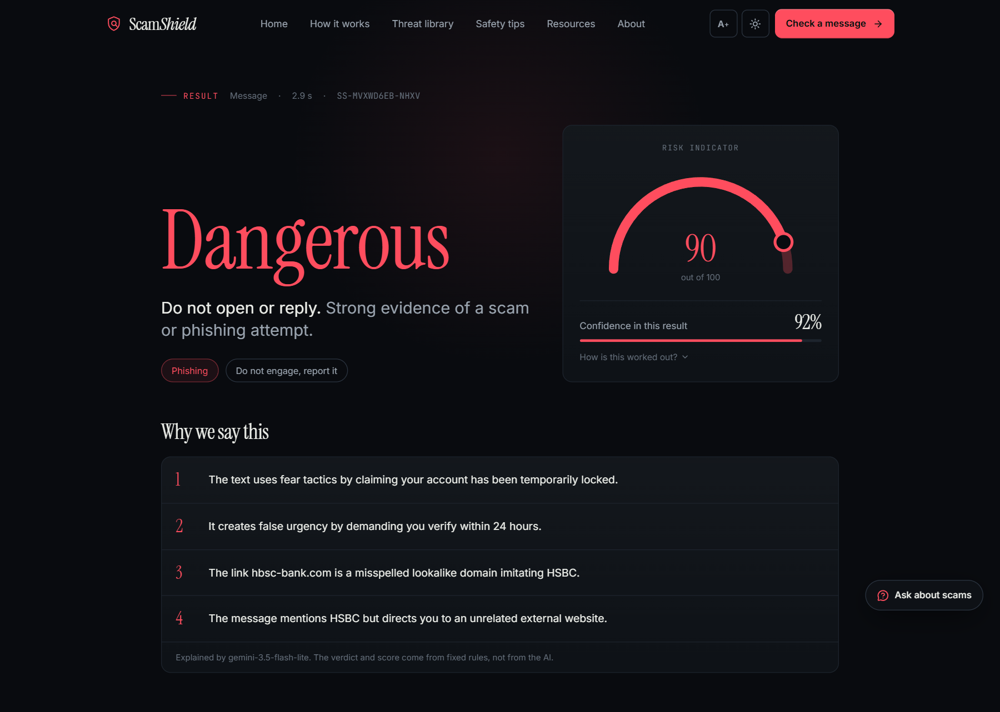

### Real vs fake: who is this pretending to be?

For every message that imitates an organisation, ScamShield shows the **real addresses** next to the **fake one**, letter by letter. The comparison is built from that message's own link, so it is different every time (a swapped-letter name like `hbsc`, a decoy like `axisbank.co.in-verify.xyz`, an email sender that only *calls itself* a bank, and so on).

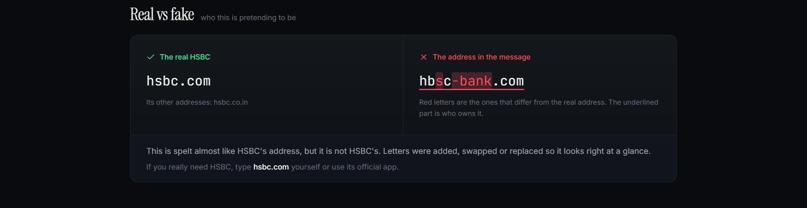

### Genuine messages are left alone

False alarms are as harmful as missed scams, because people stop trusting the tool. A genuine bank alert is recognised as one, and an advertisement is called an advertisement.

<table>
<tr>
<td width="50%">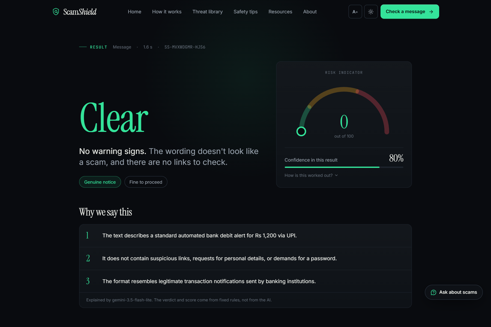</td>
<td width="50%">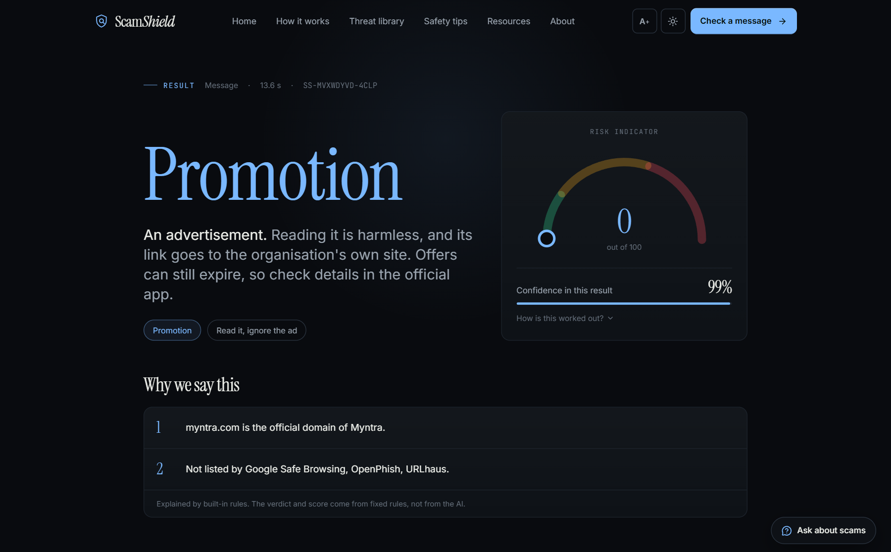</td>
</tr>
<tr>
<td align="center"><sub>Genuine bank debit alert: <b>Clear</b></sub></td>
<td align="center"><sub>Advertisement from a real brand: <b>Promotion</b></sub></td>
</tr>
</table>

### Light and dark, on any phone

A dark and a light theme, an optional large-text mode, and a layout that works from a phone screen up. The "Safety tips" page is saved on your device and **opens without internet**.

<table>
<tr>
<td width="46%">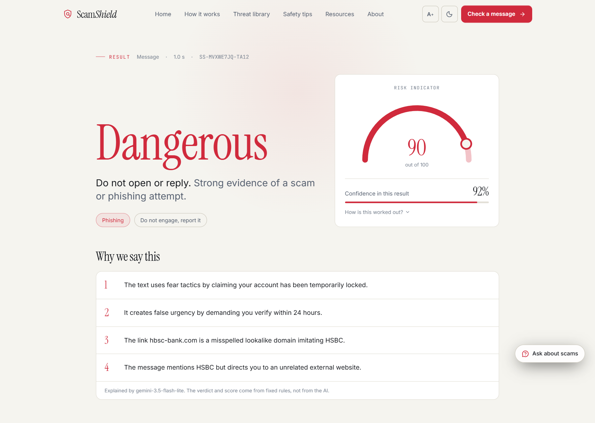</td>
<td width="18%">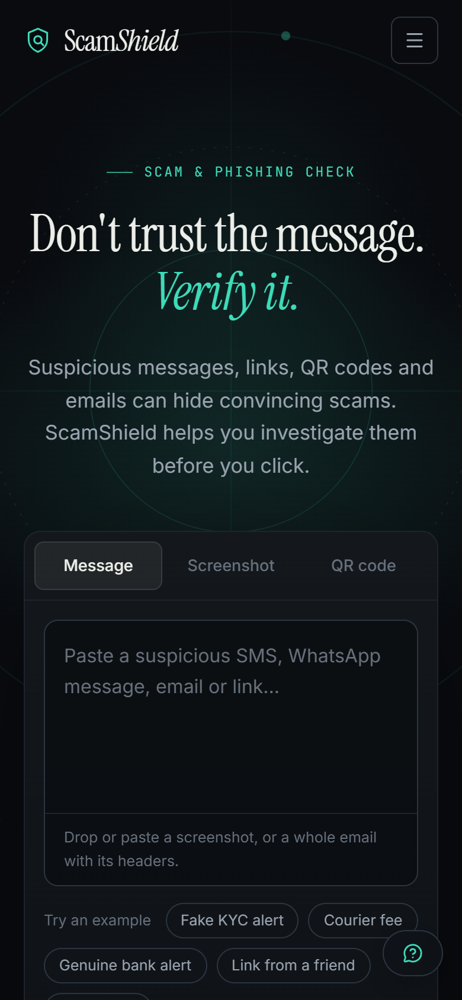</td>
<td width="18%">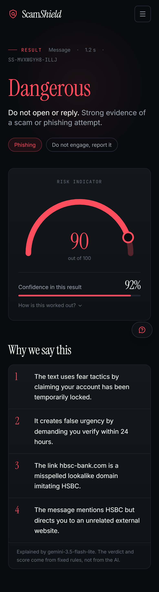</td>
<td width="18%">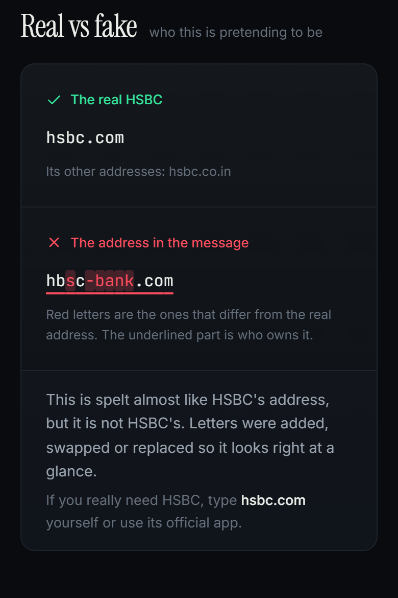</td>
</tr>
</table>

---

## How it works

### The whole workflow

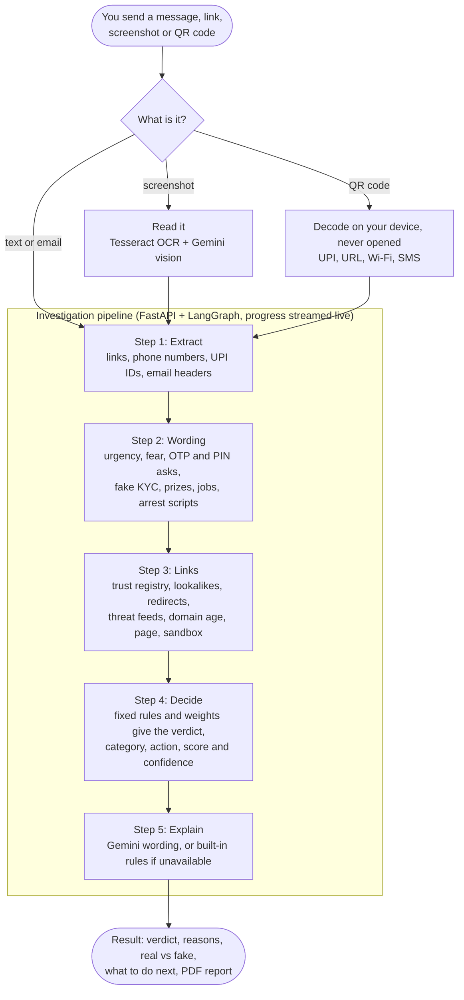

1. **Extract.** Finds every link (even ones written like `hxxps://bank[.]com` or hidden with look-alike letters), phone numbers, UPI IDs and, for a pasted email, the sender, Reply-To, authentication result, attachment names and the text-versus-target of each link.
2. **Wording.** About 25 families of rules look for pressure and persuasion: threats, urgency, requests for an OTP or PIN, fake KYC, prizes, jobs, investments, "digital arrest", remote-access apps and APK installs. Genuine informational wording ("do not share your OTP") is recognised and not scored.
3. **Links.** Each link goes through the investigation below.
4. **Decide.** Every point comes from a documented signal weight. The same link scores the same whether it was typed, read from a screenshot or scanned from a QR code.
5. **Explain.** Gemini writes the plain-language reasons. It never decides the verdict.

### How one link is investigated

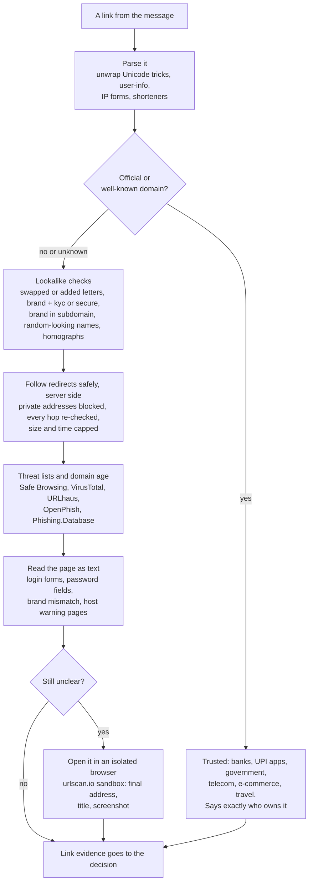

Nothing on this path runs on your device, no script on the page is ever executed by our server, and a link that merely is not on a threat list is reported as **"no problems found"**, never as "safe".

### Where the AI fits

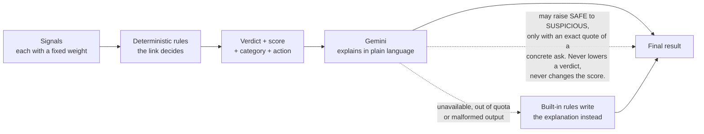

### Deployment

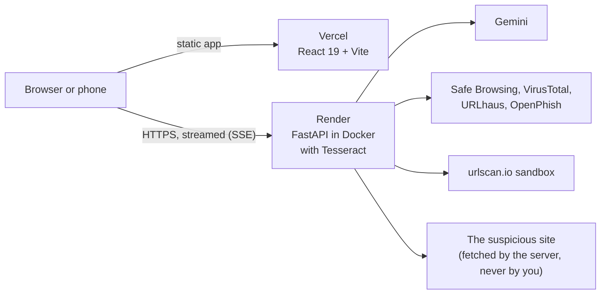

---

## What you get back

Every result carries a **verdict**, a **category** and a **recommended action**, each with its own colour so it can be read at a glance.

| Colour | Result | Meaning | Recommended action |
|:---:|---|---|---|
| 🟢 | **Safe / Clear** | Recognised as genuine, or nothing worrying was found | Fine to proceed |
| 🔵 | **Promotion** | An advertisement; its link goes to the organisation's own site | Read it, ignore the ad |
| 🟣 | **Spam** | Unwanted advertising that cannot be tied to a known organisation | Delete it |
| 🟠 | **Suspicious** | Some warning signs, not enough to be sure | Verify through an official channel |
| 🔴 | **Dangerous** | Strong evidence of phishing, fraud or malicious content | Do not open or reply; report it |
| ⚪ | **Unverified** | The link does not exist or cannot be reached, so there was nothing to inspect | Do not rely on it |

Under the verdict the app also names the **category**: *genuine notice, promotion, spam, phishing, fraud / scam, malicious content, suspicious, or no problems found*. A result also contains:

- **Why we say this**, in plain sentences, each backed by evidence you can expand.
- **A risk score (0–100)** and a **confidence figure** that is computed from how many checks finished and how much of the strong evidence agrees. It is never invented by the AI, and the app shows how it was worked out.
- **Real vs fake**, when an address imitates a known organisation.
- **Per-link inspections**, wording that matched a scam pattern, and a defanged copy of every dangerous link.
- **A PDF report** built in your browser from the actual result.

---

## How it behaves

Real outputs of the engine's built-in rules on a few messages (offline, no AI and no network checks). The live app can only add to this evidence, never remove it.

| Message | Result | Why |
|---|---|---|
| *"Rs 1,200 debited from A/c XX1234… -HDFC Bank"* | 🟢 Genuine notice | Standard automated bank alert; nothing asks you to do anything risky |
| *"482913 is your OTP for Amazon. Do not share this code with anyone."* | 🟢 Genuine notice | Warning you not to share an OTP is not asking for one |
| *"Update your KYC in the app or at netbanking.hdfcbank.com"* | 🟢 Verified | The link is the bank's official address, so KYC wording alone is not a scam |
| *"You can now log in to ICICI iMobile with your mobile number…"* + `icici.bank.in` | 🟢 Verified | Instructions are not requests, and `*.bank.in` is a licensed Indian bank |
| *"hey what's the wifi password at your place?"* | 🟢 No problems found | A Wi-Fi password is not an account secret |
| *"Flat 50% OFF at Myntra! Shop now: myntra.com/sale"* | 🔵 Promotion | Advertisement whose link is the brand's own site |
| *"HSBC Bank: your account is locked, verify KYC at `hbsc-bank.com`"* | 🔴 Phishing | Look-alike domain (two letters swapped), fear, a 24-hour deadline, a name that does not match the link |
| *"Your parcel is held. Pay Rs 25 at `dc9x35ez.top/pay`"* | 🔴 Fraud / scam | A fee for a parcel you did not order, on a random-looking `.top` address |
| *"This is CBI. You are under digital arrest… transfer Rs 50,000"* | 🔴 Fraud / scam | An arrest threat combined with a demand for money |
| *"Part time job! Earn Rs 5000 daily… message us on WhatsApp"* | 🔴 Fraud / scam | A job promise with an unverifiable channel |
| *"Please read out the 6-digit code that came on your phone"* | 🟠 Suspicious | A code being handed to a person is flagged, but on its own the rules stop at "Suspicious" |

Two things change the answer more than anything else:

- **The link decides.** Persuasive wording ("urgent", "KYC", "prize") only matters when the message also gives you something you cannot verify: an unknown link, a phone number, a UPI ID, a WhatsApp number or a request for money. If every link in a message is a verified address, the same wording is not scored.
- **Handing a secret to someone is always a problem.** Reading out a code, paying a "fee", installing a remote-access or APK app is flagged even when the link looks fine.

---

## Design principles

- **Explain, don't just label.** Every verdict lists its reasons, and the score is the sum of documented weights. There is no black box deciding the answer.
- **Deterministic first, AI second.** Fixed rules decide. Gemini only explains and can at most raise a verdict from Safe to Suspicious, and only with an exact quote of a concrete request. If Gemini is down, the app still works.
- **Honest wording.** *"No problems found"* is not *"safe"*. *"Valid payment request"* is not *"verified payee"*. *"Could not verify"* is only used when a link does not exist.
- **Fix classes of failure, not single messages.** When a genuine message was wrongly flagged, the rule was changed for the whole class (for example "instructions are not requests") and a regression test was added.
- **Never touch the suspicious thing on the user's machine.** Links are followed by the server with SSRF protection; QR codes are decoded on the device and not opened.
- **Free to run.** Every provider key is optional; with fewer sources the engine still answers and reports lower confidence.

---

## Accuracy, measured honestly

All numbers come from scripts in [`backend/scripts/`](backend/scripts) and can be re-run. Where a set was used to tune the rules, it is marked, because a tuned number is not independent evidence. The full report is in [`docs/AUDIT.md`](docs/AUDIT.md) and [`docs/STATUS.md`](docs/STATUS.md).

| Test | Result |
|---|---|
| **Links**, 1,228 labelled links, no network at all | 84.4 % of phishing detected, 1.6 % of safe sites wrongly flagged |
| **Brand-new phishing**, threat feeds switched off but pages followed | 91.9 % detected, 2.6 % false alarms on 492 live safe sites |
| **Genuine messages**, 105 notices across many sectors + 20 ads (written separately from the rules) | **0 of 125** flagged (it was 11 of 105 before the fixes) |
| **Your own real messages**, 17 real SMS, emails and adverts | 0 flagged |
| **Emails**, formal mails, spoofing, attachments, hidden links | 0 false alarms, 0 missed |
| **Unseen scam scripts**, sealed red-team set written before any fix | ~65 % get exactly the right category, but **0 malicious messages were called harmless** |
| **Messages written after the engine was frozen**, rules only | 62.5 % of scams detected, 0 % false alarms. With Gemini's second opinion this was 96 % when measured earlier |
| **Tests** | 374 backend and 25 frontend tests pass on every push |

**What that means in plain terms:** the engine is strong on the common scripts and very careful with genuine messages. On scam wording it has never seen, the rules alone catch fewer scams, and in an earlier measurement the AI second opinion closed most of that gap (it has not been re-measured since). That gap is the main weakness, and it is stated rather than hidden.

---

## Security and privacy

- **No accounts, no history.** Messages are analysed and not stored. Logs never contain message text.
- **The server fetches, you don't.** The link fetcher blocks private, loopback and metadata addresses, validates every redirect hop, **pins the connection to the validated IP** (so a DNS trick cannot swap the target), and caps size and time. It never runs a script from a page.
- **QR codes and screenshots** are decoded or read without opening anything.
- **Prompt-injection hardening.** Message text sent to Gemini is fenced and declared untrusted, output is schema-checked, and the AI cannot lower a verdict.
- **Abuse limits.** Per-IP rate limits, security headers, bounded regular expressions (a long-input slowdown was found and fixed in the audit), a bounded response cache.
- **Dependencies** are audited (`pip-audit` and `npm audit` clean at the last audit).

Open items, listed honestly: the API has rate limits but no login, and there has been no external penetration test.

---

## Tech stack

| Layer | What is used |
|---|---|
| **Backend** | Python 3.12, FastAPI, LangGraph, Pydantic, `tldextract`, `httpx`, Pillow, Tesseract OCR, OpenCV, zxing-cpp (QR decoding) |
| **Intelligence** | Trust registry of about 500 organisations (India-weighted), popularity list, lexical lookalike and combosquat detection, a small learned domain-name model, five threat feeds, domain age, text-only page inspection, urlscan.io sandbox |
| **AI** | Google Gemini for explanations, screenshot vision and the "Ask about scams" helper, always behind deterministic rules |
| **Frontend** | React 19, Vite, Tailwind CSS 4, Motion, `qr-scanner` (on device), jsPDF, Lucide icons, Vitest |
| **Offline** | A service worker keeps the app shell and the Safety tips page available without internet |
| **Hosting** | Render (Docker, free plan) for the API, Vercel for the frontend, both redeploying on every push to `main` |
| **CI** | GitHub Actions: backend tests, frontend lint, tests and build |

---

## Run it locally

Prerequisites: Python 3.12 with [`uv`](https://docs.astral.sh/uv/), Node 20+, and [Tesseract OCR](https://github.com/UB-Mannheim/tesseract/wiki) for screenshots.

```bash
cd backend && cp .env.example .env     # then fill in the keys you have (all optional)
uv sync
cd ../frontend && npm install
```

Then double-click **`start-local.bat`** on Windows, or run the two servers yourself:

```bash
cd backend && uv run uvicorn app.main:app --port 8000
cd frontend && npm run dev
```

Open http://localhost:5173.

**Camera scanner on a phone.** Browsers only allow the camera on HTTPS. Run **`start-phone.bat`**, open the `https://<your-pc-ip>:5173` address it prints on a phone on the same Wi-Fi, and accept the self-signed certificate warning. The phone serves the finished build because the dev server's reload socket can loop on phones. If the page never opens, allow Node.js through Windows Firewall on private networks. The deployed site already has HTTPS, so the camera works there directly.

### Keys (`backend/.env`, never committed)

| Variable | Used for | Required |
|---|---|---|
| `GEMINI_API_KEY` | Explanations and screenshot vision | No (built-in rules are used without it) |
| `GEMINI_CHAT_API_KEY` | The "Ask about scams" helper | No |
| `SAFE_BROWSING_API_KEY` | Google Safe Browsing | No |
| `VIRUSTOTAL_API_KEY` | VirusTotal domain reputation (free tier: 4/min) | No |
| `URLHAUS_AUTH_KEY` | abuse.ch URLhaus | No |
| `URLSCAN_API_KEY` | Real-browser sandbox scans on urlscan.io | No |
| `TELEGRAM_BOT_TOKEN` | The Telegram bot (from @BotFather) | No (the bot is off without it) |

OpenPhish and the popular-sites list need no key. How to get each key: [`docs/playbook/KEYS.md`](docs/playbook/KEYS.md).

### API

| Endpoint | Purpose |
|---|---|
| `GET /health` | Status, version and which providers are configured |
| `POST /investigate` | Analyse a message, link or whole email (`/investigate/stream` streams live progress) |
| `POST /investigate/image` | Analyse a screenshot |
| `POST /investigate/qr`, `/investigate/qr-text` | Analyse a QR image or already-decoded QR text |
| `POST /chat` | The "Ask about scams" assistant |
| `POST /telegram/webhook` | Where Telegram delivers messages sent to the bot (needs Telegram's secret header) |

### Tests and benchmarks

```bash
cd backend
uv run pytest -q                                                  # 374 offline tests
uv run python scripts/evaluate.py                                 # link benchmark, static (no network)
uv run python scripts/evaluate.py --live                          # + live threat-feed lookups (never opens suspicious links)
uv run python scripts/eval_messages.py                            # SMS benchmark
uv run python scripts/eval_genuine.py --show                      # genuine notices and promotions
uv run python scripts/eval_emails.py                              # emails
uv run python scripts/eval_redteam.py --file redteam_sealed.csv   # unseen scam scripts, per-category scores
cd ../frontend && npm test && npm run lint && npm run build
```

---

## Deployment

The app is split in two and both halves redeploy automatically on every push to `main`.

| Part | Host | Config |
|---|---|---|
| **API** | [Render](https://render.com), Docker web service | [`render.yaml`](render.yaml), [`backend/Dockerfile`](backend/Dockerfile) (includes Tesseract). Health check on `/health`. Set `CORS_ORIGINS` to the Vercel address and add the optional keys. |
| **Frontend** | [Vercel](https://vercel.com), static build | Root directory `frontend`, [`vercel.json`](frontend/vercel.json) with security headers. Set `VITE_API_BASE_URL` to the Render address. |

Live: **app** [scamshield-smoky.vercel.app](https://scamshield-smoky.vercel.app/) · **API health** [scamshield-api-loes.onrender.com/health](https://scamshield-api-loes.onrender.com/health)

---

## Project layout

```text
backend/app/intel/    link intelligence: parsing, trust registry, lookalikes, safe fetcher, feeds, domain age, page inspection, email parsing
backend/app/engine/   signals and weights, wording rules, verdict and confidence, classification, pipeline steps, explanation
backend/app/qr/       QR payload types and UPI analysis
backend/app/graph/    LangGraph pipeline
backend/app/api/      REST and streaming endpoints
backend/scripts/      benchmark and evaluation scripts
backend/tests/        374 offline tests
frontend/src/         React app: components, sections, lib (verdicts, domains, PDF), offline service worker
data/benchmark/       labelled links, messages, emails and red-team sets used by the evaluators
docs/                 AUDIT, STATUS, screenshots, test QR sheet, development playbook
```

---

## Known limits

Stated plainly, because a tool that judges honesty should be honest:

- **Unseen scam wording.** Rules alone catch about 60–90 % of unfamiliar scam scripts. Gemini lifts this, but it depends on quota and was not re-measured after the latest rule changes.
- **Day-zero phishing** on a clean-looking domain with a JavaScript-only page can still be missed (about 8 % in our test).
- **Spam versus scam is a judgement call.** Scammy spam with a link ("free gifts, click here") is called *suspicious* rather than *spam*.
- **Languages.** Wording rules cover English, Hindi (Devanagari) and Hinglish. Other Indian languages are caught only when their link is bad.
- **Email authentication** is read from a pasted result header only; SPF, DKIM and DMARC are not verified by us.
- **A valid UPI QR** is reported as a valid request. We cannot confirm who really owns the account.
- **No login** on the API (rate limits only) and **no external penetration test**.
- Test messages were mostly written by us; the real-world false-alarm rate on messages nobody here has seen is unknown beyond the 17 real ones tested.

---

## About

ScamShield is a TY Semester 5 EDI project by **Shail Kamtikar**.

*An Agentic Multimodal Framework for Explainable Cross-Channel Scam Investigation and Risk Assessment.*
